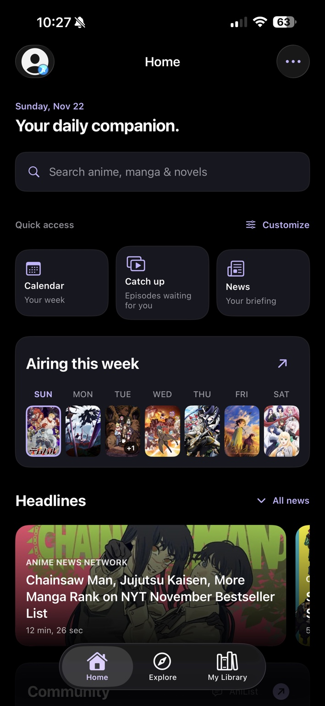
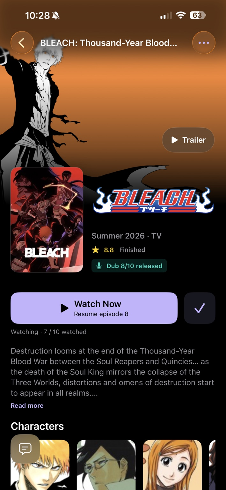
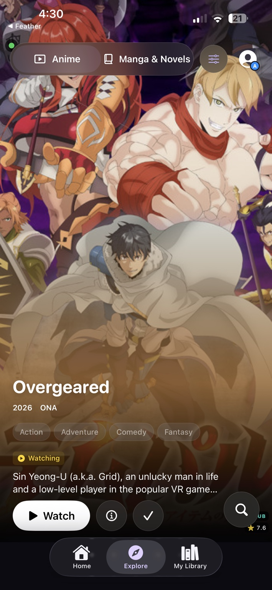
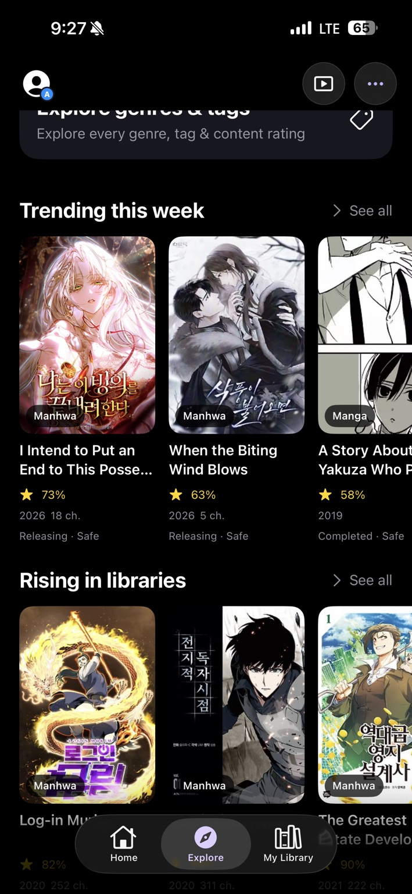
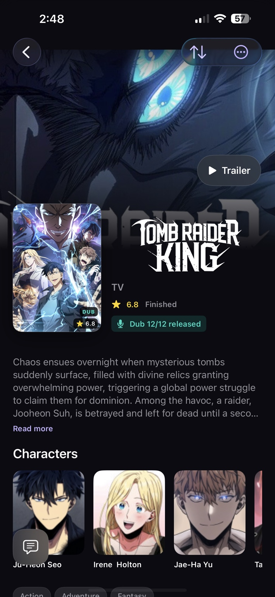
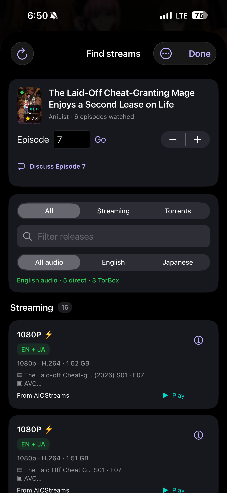

<div align="center">

# Anime Companion

### Your next anime. Your entire manga shelf.

Discover anime, manga and novels. Keep your place. Make it yours.

**iPhone & iPad · AniList & MangaBaka · Your sources · Your player**

[Get a build](https://github.com/goon-123/AnimeCompanion/actions/workflows/ios-build.yml) · [Features](#made-for-your-daily-watch-and-read) · [Sources & players](#your-sources-your-player) · [Setup](#get-started)

</div>

## A closer look

<table>
  <tr>
    <td align="center" width="33%"><strong>Your daily companion</strong><br><sub>Releases, headlines and quick access.</sub></td>
    <td align="center" width="33%"><strong>Every story in focus</strong><br><sub>BLEACH: Thousand-Year Blood War</sub></td>
    <td align="center" width="33%"><strong>Find your next favorite</strong><br><sub>Overgeared in Explore</sub></td>
  </tr>
  <tr>
    <td align="center"><a href="docs/assets/screenshots/home.jpg"></a></td>
    <td align="center"><a href="docs/assets/screenshots/anime-details-bleach.jpg"></a></td>
    <td align="center"><a href="docs/assets/screenshots/anime-discovery-overgeared.jpg"></a></td>
  </tr>
  <tr>
    <td align="center"><strong>A shelf beyond anime</strong><br><sub>Manga, manhwa, novels and discovery.</sub></td>
    <td align="center"><strong>Go deeper into a series</strong><br><sub>Tomb Raider King details and characters.</sub></td>
    <td align="center"><strong>Find it. Choose it. Play it.</strong><br><sub>AIOStreams results and audio filters.</sub></td>
  </tr>
  <tr>
    <td align="center"><a href="docs/assets/screenshots/manga-discovery.jpg"></a></td>
    <td align="center"><a href="docs/assets/screenshots/anime-details-tomb-raider-king.jpg"></a></td>
    <td align="center"><a href="docs/assets/screenshots/stream-picker.png"></a></td>
  </tr>
</table>

<sub>Actual in-app captures from different app versions. Tap an image for the full screenshot. Artwork, availability and layouts may change.</sub>

## Made for your daily watch and read

- **Discover something worth starting.** Cinematic artwork, seasonal picks, trending titles, genres, studios and related series make exploring feel like browsing a collection.
- **Keep your place.** Organize anime with AniList, track manga and novels with MangaBaka, and keep watching and reading progress close in My Library.
- **Know what's next.** Weekly schedules, premiere countdowns, English dub information and catch-up views help you follow your shows.
- **Read in the app.** Compatible manga sources open in a built-in reader with saved reading progress, webtoon scrolling and automatic next-chapter loading.
- **Build your own Home.** Hide and rearrange widgets and shelves, choose list or grid layouts, and customize the bottom navigation.
- **Stay in the conversation.** Read AniList discussions and follow anime headlines alongside your library and discovery feeds.
- **Feel at home on either screen.** Native SwiftUI layouts for iPhone and iPad, with light, dark and system appearance options.

## Your sources. Your player.

**AIOStreams is the main streaming setup.** Add your own AIOStreams manifest through the app's Stremio add-on settings, browse the available results, then send a selected stream to your preferred player. Multiple compatible Stremio add-ons can be installed alongside it.

| Integration | What it brings to the app |
| --- | --- |
| [AIOStreams](https://github.com/Viren070/AIOStreams) / Stremio add-ons | Episode sources, reported audio languages, quality details and compatible add-on catalogs. Playback requires a direct HTTP(S) video URL. |
| [Seanime](https://github.com/5rahim/seanime) compatibility | A supported subset of anime torrent-provider extensions runs on the device. Choose a result and file, then use TorBox for playback. No Seanime server is required. |
| [Keiyoushi](https://keiyoushi.github.io/) compatibility | Browse, install and update manga extensions, then read through supported sources. Compatibility is experimental and varies by extension. |

Seanime support covers a limited provider API, and Keiyoushi support does not cover every extension. See the [Seanime runtime](Tools/SeanimeRuntime/README.md) and [manga compatibility notes](docs/manga-compatibility/README.md) for details.

### Playback, your way

Choose **VidHub, Infuse or Outplayer** during setup or under **Settings → Sources & playback → Video player**. The selection applies to native Watch, add-on catalogs and TorBox files.

| Player | Playback support |
| --- | --- |
| **VidHub** | External video playback, subtitles and resume callbacks on supported versions. |
| **Infuse** | External video playback and subtitles; version 8.4.7 or later supports resume callbacks. Mark episodes watched in Anime Companion because Infuse does not report completion. |
| **Outplayer** | External video playback, subtitles, resume position and completion callbacks. |

The selected player must be installed separately. The included Safari → VidHub extension continues to open videos in VidHub.

## Get started

1. **Install a build.** Download the unsigned IPA artifact from a successful [GitHub Actions build](https://github.com/goon-123/AnimeCompanion/actions/workflows/ios-build.yml), then sign and install it using your preferred method. Supports iOS/iPadOS 17 or later; the optional Safari extension requires 18 or later.
2. **Make it yours.** Follow the setup guide, connect AniList and/or MangaBaka, and choose your player. Public catalog browsing is available without signing in.
3. **Bring your sources.** Add your AIOStreams/Stremio install link and configure any compatible extensions or TorBox connection you want to use.

Anime Companion is a client for your configured services and sources. It does not include a streaming subscription or host anime or manga content.

<details>
<summary><strong>Building from source & developer notes</strong></summary>

Requires Xcode 26 or newer, Node.js 22+ and XcodeGen. On a Mac:

```sh
brew install xcodegen
bash scripts/build-ios.sh
```

See [build status](BUILD_STATUS.md), [build performance notes](docs/ipa-build-performance.md), and the [previous README](docs/README_ARCHIVE.md) for setup details, historical release notes and validation instructions. AniList's client-ID and redirect setup is documented [here](docs/README_ARCHIVE.md#anilist-sign-in-setup).

</details>

<details>
<summary><strong>Credits & screenshot information</strong></summary>

Anime metadata and tracking use [AniList](https://anilist.co); manga and novel discovery and tracking use [MangaBaka](https://mangabaka.org). Dub information uses AniSchedule and [MyDubList](https://mydublist.com) data, with attribution and licenses in the app and the [data-source notes](docs/README_ARCHIVE.md#data-sources-and-attribution). Artwork and series logos belong to their respective owners. News links open the original publishers.

The screenshots show the actual app with real catalog entries. They were captured across app versions and retain their original UI pixels. Dates, release counts and library progress reflect the moment of capture. See [screenshot provenance](docs/assets/screenshots/README.md).

</details>
